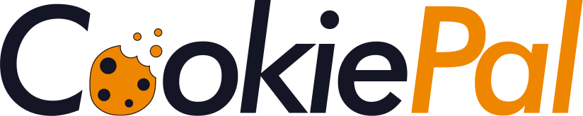
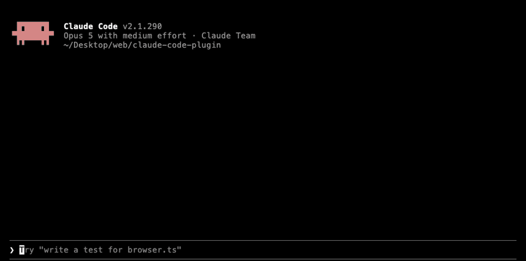

<div align="center"><a name="readme-top"></a>

<picture>
  <source media="(prefers-color-scheme: dark)" srcset="assets/logo-dark.svg">
  
</picture>

<strong>Cookie Consent Made Easy, now inside Claude Code</strong>

**Privacy made simple.** Check any page for the cookies and trackers that fire before consent, and find out what its banner's reject button actually does. Runs on your machine. No account needed to check.

<!-- SHIELD GROUP -->

[![License][license-shield]][license-link]
[![Works with Claude Code][claude-code-shield]][claude-code-link]
[![No Account][no-account-shield]][no-account-link]

</div>

## 📺 Demo

<div align="center">
<!-- MEDIA: hero.gif. One /cookiepal:check run, start to verdict.
     Record with docs/media/hero.tape. See docs/media/README.md. -->

</div>

<details>
<summary><kbd>Table of contents</kbd></summary>

#### TOC

- [📺 Demo](#-demo)
- [🤔 Why](#-why)
- [👋 Getting started](#-getting-started)
- [✨ What a check tells you](#-what-a-check-tells-you)
  - [🚦 Three passes over the page](#-three-passes-over-the-page)
  - [⚖️ What each law asks for](#️-what-each-law-asks-for)
  - [📄 Four ways to read the result](#-four-ways-to-read-the-result)
  - [👆 It only ever clicks one button](#-it-only-ever-clicks-one-button)
- [🔐 What is sent to CookiePal](#-what-is-sent-to-cookiepal)
  - [🆔 The install ID](#-the-install-id)
- [🔑 Connect a CookiePal account](#-connect-a-cookiepal-account)
- [🔄 Update and uninstall](#-update-and-uninstall)
- [📦 What is in this repository](#-what-is-in-this-repository)
- [🤝 Contributing](#-contributing)
- [📜 Legal](#-legal)

<br/>

</details>

## 🤔 Why

The GDPR requires user approval for certain cookies, you have to tell people what you collect and why, and failing to follow the rules leads to fines and legal trouble. None of that is news. What is hard is knowing whether your own site actually does what your banner says it does.

Most banners are not honest about **reject**. A page sets its analytics and advertising cookies the moment it loads, the banner appears after the fact, and pressing "reject all" quietly leaves half of them running.

You can find that out with devtools, a clean browser profile and twenty minutes per page. Or you can ask, from the editor you are already in, and get an answer in one line.

CookiePal loads one page in a throwaway browser profile on your machine, records what was set before anyone agreed to anything, then presses the banner's accept and reject buttons and tells you what each one actually did. Cheap, easy, fast, like the rest of [CookiePal](https://cookiepal.io).

## 👋 Getting started

Paste this into Claude Code and it will install CookiePal itself:

```
Install the CookiePal plugin for me. Run these in Bash:
  claude plugin marketplace add westpoint-io/claude-code-plugin
  claude plugin install cookiepal@cookiepal
Then tell me to run /reload-plugins myself, and what to expect from /mcp.
```

Or do it yourself:

- **In Claude Code**

  ```
  /plugin marketplace add westpoint-io/claude-code-plugin
  /plugin install cookiepal@cookiepal
  /reload-plugins
  ```

- **From your terminal**

  ```sh
  claude plugin marketplace add westpoint-io/claude-code-plugin
  claude plugin install cookiepal@cookiepal
  ```

  Then run `/reload-plugins` in any Claude Code session that is already open.

Run `/mcp` and you should see `cookiepal` listed as connected. Then:

```
/cookiepal:check https://example.com
```

Requires [Node.js](https://nodejs.org) 18+ and Google Chrome, Microsoft Edge, Brave or Chromium. If your browser lives somewhere unusual, point `COOKIEPAL_BROWSER` at its executable.

## ✨ What a check tells you

### 🚦 Three passes over the page

Each in a fresh temporary profile:

| Pass | Question it answers |
| --- | --- |
| **Arrival** | What was set before you touched anything? |
| **Accept** | What does agreeing actually turn on? |
| **Reject** | What is *still* running after you said no? |

That third row is usually the interesting one.

You get every cookie with its category, every third-party host the page contacted, and what changed between the three passes.

### ⚖️ What each law asks for

<!-- MEDIA (optional): risk-read.png. A still of the rendered read, which a
     terminal recording cannot show. See docs/media/README.md. -->

The result comes with a plain-language read against the **GDPR**, the **CCPA and CPRA**, the **LGPD** and **Quebec's Law 25**. The laws disagree about whether tracking needs permission up front or only a way to opt out, so each gets its own answer instead of a single meaningless score.

Every sentence it prints about a law is fixed text that ships with the plugin and is reviewed before release, so the explanation cannot drift or be reworded by the model running it.

**It will never tell you that a site is compliant.** One page, loaded once, from one country, cannot show that, and we are not your lawyers. It tells you what was found and what each law asks for. The read is advisory and is not legal advice.

### 📄 Four ways to read the result

```
/cookiepal:check https://example.com artifact    # published to claude.ai, only after you say yes
/cookiepal:check https://example.com html        # a local HTML file
/cookiepal:check https://example.com markdown    # a local .md file
/cookiepal:check https://example.com terminal    # straight to your terminal
```

Same words every time. Only the styling differs. Before publishing anything, the first check asks whether to; **the default is no**, which keeps the read in a local HTML file, and your answer is remembered. Artifacts need a signed-in claude.ai account on a paid plan; the other three work on any plan and **send the read nowhere at all**. Set one as your default if you would rather artifacts were never used.

### 👆 It only ever clicks one button

The check presses one consent button and nothing else. If it cannot find a banner, or more than one button matches, it reports what was set on arrival and tells you the consent action was not tested. **It never presses a button it is unsure of.**

The matchers that find those buttons are delivered by CookiePal with each check, so they get better without you updating anything.

It works on any page your machine can reach, including `localhost` and pre-release sites a hosted scanner can never see.

## 🔐 What is sent to CookiePal

Only what it takes to count checks and store the result:

- the page's **origin and path**. The query string and fragment are stripped before anything is sent, because they carry tokens, and the plugin refuses to send an address that still has one;
- each cookie's **name, domain, path, expiry, flags and category**, but **never its value**, which the server has no field for and rejects outright;
- the **third-party hosts** the page contacted;
- what the **accept and reject** presses did: whether each button was pressed, and the same cookie details and third-party hosts as above, read after each press;
- the **plugin version**;
- the **country** the check ran from, worked out from your IP address, which is **not stored**;
- a **random install ID**, only if you agreed to share one.

Asking CookiePal to confirm your banner is installed sends one more reading, and only when you ask for it. The page is loaded on **your** machine, never by CookiePal, and what goes up is the page's **origin and path**, **when it was read**, the **CookiePal banner script** found there with its query string stripped, that **script's tag** rebuilt from its `id`, `type`, `defer` and `async` attributes alone, and whether the page **could not be read** at all. Nothing else from the page goes with it, and the reading sets that domain's banner status in your CookiePal account.

If you connect a CookiePal account with `/cookiepal:connect`, you are asked separately whether to link a shared install ID to it, so CookiePal can tell that checks led to a signup. The default is no. A hook in the plugin refuses to send the ID without an answer recorded on this machine, and in Claude Code's default permission mode it asks you to confirm a yes in its own dialog before the ID is sent. That dialog is skipped in bypass-permissions mode, and the hook does not run when hooks are turned off. Answering no on a later connect removes a link you made before.

One other thing leaves your machine, and only when you ask for it: running `/cookiepal:check stop-sharing` sends the install ID once more, on its own, so the checks stored under it can be erased. Nothing else accompanies it.

**The page is loaded by you, on your machine. CookiePal never loads it.** Cookies are categorised locally against the open-source [`@cookiepal-oss/cookie-db`](https://www.npmjs.com/package/@cookiepal-oss/cookie-db) catalogue, so nothing is sent anywhere to be identified. The risk read is assembled locally too.

The check never uses your own browser profile, so your cookies and sign-ins are never opened and never read.

Because this runs inside Claude Code, the page address, the cookies and the result also pass through your own Claude Code session, under your own agreement with Anthropic. CookiePal neither controls that nor receives a copy.

Stored checks are deleted automatically after 180 days. Full detail: [privacy notice](https://cookiepal.io/plugin-privacy).

### 🆔 The install ID

We would like to know how many *people* use this, rather than only how many checks run. The first check asks you once whether to share a random install ID. **The default is no, and the check works either way.** It is created only after a yes, lives in the plugin's data folder, and goes when you uninstall.

To stop sharing it and delete it:

```
/cookiepal:check stop-sharing
```

That also deletes the checks you already submitted, and unlinks the ID from your CookiePal account if you connected one: the plugin sends the ID to CookiePal one last time and, once the server confirms every check stored under it is gone, removes the ID from this machine. You are told how many went.

If the erasure does not go through, the ID deliberately stays put — it is the only thing that can find those checks — so sharing has not stopped yet and running the command again is safe, because it deletes only what is left. If the ID is already gone from this machine but you kept a copy, send it to [support@cookiepal.io](mailto:support@cookiepal.io) and we will erase anything left under it.

## 🔑 Connect a CookiePal account

The check never needs an account. To use CookiePal on a site you run, connect one:

```
/cookiepal:connect
```

A CookiePal page opens in your browser. If you are already signed in to CookiePal there, press Connect and you are done. If not, sign in, continue with Google, or create a free account (in a new tab), then come back and press Connect. Your password never passes through the terminal, and the plugin never sees it. If you shared an install ID, you are asked whether to link it to the account, every time you connect. The link is deleted after 180 days, when you answer no on a later connect, or straight away with `/cookiepal:check stop-sharing`.

Once connected, you can ask Claude which domains the account has, with each one's plan, or to add one. A domain added this way starts on the free plan, and an account can add up to 10 a day like this. Nothing is scanned on CookiePal's side: run `/cookiepal:check` on the new domain to see its cookies.

## 🔄 Update and uninstall

```sh
claude plugin marketplace update cookiepal
claude plugin update cookiepal@cookiepal
```

Then run `/reload-plugins` in any Claude Code session that is already open. To remove it entirely:

```
/plugin uninstall cookiepal@cookiepal
/plugin marketplace remove cookiepal
```

## 📦 What is in this repository

The plugin itself: the manifests, the `/cookiepal:check` and `/cookiepal:connect` commands, the `check-one-page`, `connect-account` and `verify-installation` skills, the local check in `src/`, the curated legal wording in `src/laws.ts`, and the hooks that hand each plan, each result and each install tag to that check and refuse an install reading no local run produced.

Plugins install from git with no build step, so `dist/check.mjs` is the committed bundle of `src/` and its one dependency. Rebuild it with `pnpm build`; CI fails when it is out of date.

`plan_check`, `submit_check`, `forget_install`, `connect_account`, `whoami`, `list_domains`, `add_domain`, `get_install_snippet` and `verify_installation` are served by CookiePal's hosted MCP server at `https://mcp.cookiepal.io/mcp`, which is not open source.

## 🤝 Contributing

Contributions are welcome. See [CONTRIBUTING.md](CONTRIBUTING.md) for the build, test and lint commands and the code conventions.

## 📜 Legal

- [Privacy notice](https://cookiepal.io/plugin-privacy). What a check sends, what never leaves your machine, and how to have it deleted.
- [Terms of service](https://cookiepal.io/plugin-terms). The free hosted service. You accept them by using it.
- The plugin's own code is [MIT](LICENSE) licensed. That licence covers the code in this repository; it does not cover the hosted service, which the terms above do.

Only check pages you own, operate, or are otherwise entitled to test.

CookiePal is a product of [Westpoint](https://westpoint.io). Claude and Claude Code are trademarks of Anthropic, used here only to say what this plugin works with.

<div align="right">

[![][back-to-top]](#readme-top)

</div>

<!-- LINK GROUP -->

[back-to-top]: https://img.shields.io/badge/-BACK_TO_TOP-151515?style=flat-square
[license-shield]: https://img.shields.io/badge/license-MIT-EF8600?labelColor=222322&style=flat-square
[license-link]: ./LICENSE
[claude-code-shield]: https://img.shields.io/badge/works_with-Claude_Code-EF8600?labelColor=222322&style=flat-square
[claude-code-link]: https://claude.com/claude-code
[no-account-shield]: https://img.shields.io/badge/account-not_required_to_check-EF8600?labelColor=222322&style=flat-square
[no-account-link]: #-what-is-sent-to-cookiepal
