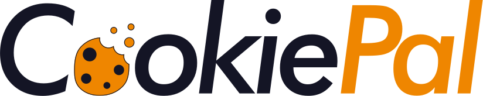
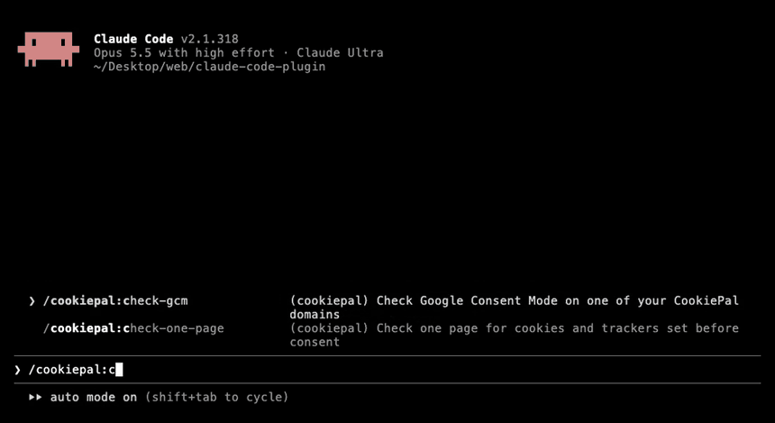

<div align="center"><a name="readme-top"></a>

<picture>
  <source media="(prefers-color-scheme: dark)" srcset="assets/logo-dark.svg">
  
</picture>

<strong>Cookie Consent Made Easy, inside Claude Code, Codex, Cursor and any MCP client</strong>

**Privacy made simple.** Check any page for the cookies and trackers that fire before consent, and find out what its banner's reject button actually does. Runs on your machine. No account needed to check.

CookiePal is also a hosted MCP server at `https://mcp.cookiepal.io/mcp`, for claude.ai, Claude Desktop and any other MCP client: [use it anywhere](#-use-cookiepal-in-any-mcp-client).

<!-- SHIELD GROUP -->

[![License][license-shield]][license-link]
[![Works with Claude Code][claude-code-shield]][claude-code-link]
[![Also in Codex and Cursor][agents-shield]][agents-link]
[![Remote MCP server][mcp-shield]][mcp-link]
[![No Account][no-account-shield]][no-account-link]

</div>

## 📺 Demo

<div align="center">

</div>

<details>
<summary><kbd>Table of contents</kbd></summary>

#### TOC

- [📺 Demo](#-demo)
- [🤔 Why](#-why)
- [👋 Getting started](#-getting-started)
- [🧩 Use the plugin in Codex or Cursor](#-use-the-plugin-in-codex-or-cursor)
- [🔌 Use CookiePal in any MCP client](#-use-cookiepal-in-any-mcp-client)
- [✨ What a check tells you](#-what-a-check-tells-you)
  - [🚦 Three passes over the page](#-three-passes-over-the-page)
  - [⚖️ What each law asks for](#️-what-each-law-asks-for)
  - [📄 Four ways to read the result](#-four-ways-to-read-the-result)
  - [👆 It only ever clicks one button per run](#-it-only-ever-clicks-one-button-per-run)
- [🔐 What is sent to CookiePal](#-what-is-sent-to-cookiepal)
  - [🆔 The install ID](#-the-install-id)
- [🔑 Connect a CookiePal account](#-connect-a-cookiepal-account)
- [🕷️ Scan a domain](#️-scan-a-domain)
- [🏷️ Install the banner](#️-install-the-banner)
- [🎨 Match the banner to your design](#-match-the-banner-to-your-design)
- [🔄 Update and uninstall](#-update-and-uninstall)
- [📦 What is in this repository](#-what-is-in-this-repository)
- [🤝 Contributing](#-contributing)
- [📜 Legal](#-legal)

<br/>

</details>

## 🤔 Why

The GDPR requires user approval for certain cookies, you have to tell people what you collect and why, and failing to follow the rules leads to fines and legal trouble. None of that is news. What is hard is knowing whether your own site actually does what your banner says it does.

Most banners are not honest about **reject**. A page sets its analytics and advertising cookies the moment it loads, the banner appears after the fact, and pressing "reject all" quietly leaves half of them running.

You can find that out with devtools, a clean browser profile and twenty minutes per page. Or you can ask, from the editor you are already in, and get an answer in one line.

CookiePal loads one page in a throwaway browser profile on your machine, records what was set before anyone agreed to anything, then presses the banner's accept and reject buttons and tells you what each one actually did. Cheap, easy, fast, like the rest of [CookiePal](https://cookiepal.io).

## 👋 Getting started

Paste this into Claude Code and it will install CookiePal itself:

```
Install the CookiePal plugin for me. Run these in Bash:
  claude plugin marketplace add cookiepal/cookiepal-plugin
  claude plugin install cookiepal@cookiepal
Then tell me to run /reload-plugins myself, and what to expect from /mcp.
```

Or do it yourself:

- **In Claude Code**

  ```
  /plugin marketplace add cookiepal/cookiepal-plugin
  /plugin install cookiepal@cookiepal
  /reload-plugins
  ```

- **From your terminal**

  ```sh
  claude plugin marketplace add cookiepal/cookiepal-plugin
  claude plugin install cookiepal@cookiepal
  ```

  Then run `/reload-plugins` in any Claude Code session that is already open.

Run `/mcp` and you should see `plugin:cookiepal:cookiepal` listed as connected. Then:

```
/cookiepal:check-one-page https://example.com
```

Requires [Node.js](https://nodejs.org) 18 or later and Google Chrome, Microsoft Edge, Brave or Chromium. If your browser lives somewhere unusual, point `COOKIEPAL_BROWSER` at its executable.

For a step-by-step walkthrough of every command and how to read its result, see the [CookiePal for Claude Code guide](https://cookiepal.io/help-guide/installation/cookiepal-for-claude-code) in the CookiePal Help Guide.

## 🧩 Use the plugin in Codex or Cursor

The same plugin runs in Codex and Cursor, with the same local check. Their copies of the skills run `@cookiepal-oss/agent` through npx, so you need [Node.js](https://nodejs.org) 18 or later and one of the browsers above. There are no `/cookiepal:` commands there: ask for a skill by name or in your own words. The read goes to a local HTML or Markdown file, or to the chat, never to a claude.ai artifact.

- **Codex**

  ```sh
  codex plugin marketplace add cookiepal/cookiepal-plugin
  codex plugin add cookiepal@cookiepal
  ```

  The first check asks you once to let the agent's npx command run outside the sandbox. Banner changes and linking your install ID wait for Codex's own approval prompt. To remove it, run `codex plugin remove cookiepal@cookiepal` and `codex plugin marketplace remove cookiepal`.

- **Cursor**: once CookiePal is in the Cursor Marketplace, open **Customize** in the sidebar and install it from there. Until then, install it as a local plugin and run **Developer: Reload Window**:

  ```sh
  git clone https://github.com/cookiepal/cookiepal-plugin ~/.cursor/plugins/local/cookiepal
  ```

  Cursor asks you to sign in to CookiePal when it connects, even to check a page, because it only offers sign-in when a server refuses the connection; you can create a free account there. Cursor doesn't run a plugin's own hooks, so the first check asks to add two hooks to `~/.cursor/hooks.json`, and says what they do. Uninstalling the plugin leaves them in place: ask Cursor to remove the CookiePal hooks before you uninstall.

## 🔌 Use CookiePal in any MCP client

CookiePal is also a hosted MCP server, so you can use it without Claude Code: from a chat on claude.ai, in Claude Desktop or the Claude mobile apps, or in any other client that connects to remote MCP servers over streamable HTTP.

```
https://mcp.cookiepal.io/mcp
```

- **claude.ai, Claude Desktop and the Claude mobile apps**: add it as a custom connector. The [CookiePal connector for Claude guide](https://cookiepal.io/help-guide/installation/cookiepal-connector-for-claude) walks you through it.
- **Other clients**: add it as a remote server. Most clients take a config like this one:

  ```json
  {
    "mcpServers": {
      "cookiepal": { "url": "https://mcp.cookiepal.io/mcp" }
    }
  }
  ```

From any client you can list the domains in your CookiePal account and add new ones, get the banner tag to paste into your page head, switch the banner between GDPR, CCPA or both, change its colours, position and texts, read a domain's latest cookie scan report, and set a cookie's category.

You need no account to add the server. The first time a tool needs your account, your client asks you to sign in, with OAuth, on CookiePal's own pages, so your password never passes through the client.

Checking a page for cookies set before consent, verifying the banner is live, checking Google Consent Mode and scanning a domain all load your site in a browser on your own machine, never on CookiePal's side. Those need this plugin, in Claude Code, Codex or Cursor. Afterwards, any client can read what they saved to your account: the latest scan report, and whether the banner was found installed.

The server is listed in the [Official MCP Registry](https://registry.modelcontextprotocol.io) as `io.cookiepal/cookiepal`.

## ✨ What a check tells you

### 🚦 Three passes over the page

Each in a fresh temporary profile:

| Pass | Question it answers |
| --- | --- |
| **Arrival** | What was set before you touched anything? |
| **Accept** | What does agreeing actually turn on? |
| **Reject** | What is *still* running after you said no? |

That third row is usually the interesting one.

You get every cookie with its category, every third-party host the page contacted, and what changed between the three passes.

### ⚖️ What each law asks for

<!-- MEDIA (optional): risk-read.png. A still of the rendered read, which a
     terminal recording cannot show. See docs/media/README.md. -->

The result comes with a plain-language read against the **GDPR**, the **CCPA and CPRA**, the **LGPD** and **Quebec's Law 25**. The laws disagree about whether tracking needs permission up front or only a way to opt out, so each gets its own answer instead of a single meaningless score.

Every sentence it prints about a law is fixed text that ships with the plugin and is reviewed before release, so the explanation cannot drift or be reworded by the model running it.

**It will never tell you that a site is compliant.** One page, loaded once, from one country, cannot show that, and we are not your lawyers. It tells you what was found and what each law asks for. The read is advisory and is not legal advice.

### 📄 Four ways to read the result

```
/cookiepal:check-one-page https://example.com artifact    # published to claude.ai, only after you say yes
/cookiepal:check-one-page https://example.com html        # a local HTML file
/cookiepal:check-one-page https://example.com markdown    # a local .md file
/cookiepal:check-one-page https://example.com terminal    # straight to your terminal
```

Same words every time. Only the styling differs. Publishing uploads the page checked, every cookie name and every third-party host to claude.ai, so before publishing anything the first check asks whether to; **the default is no**, which keeps the read in a local HTML file, and your answer is remembered. Artifacts need a signed-in claude.ai account on a paid plan; the other three work on any plan and **send the read nowhere at all**. Whichever form you pick, `terminal` included, every check writes the read to its HTML and `.md` files in the plugin's data folder, and the files for your last 20 checks are kept there. When a lot is left after reject, the terminal reads it by vendor, as it does the arrival, with every cookie listed in those files. Set one as your default if you would rather artifacts were never used: `/cookiepal:check-one-page html`, with no URL, makes the local HTML file the default.

### 👆 It only ever clicks one button per run

The accept run presses the banner's accept button and the reject run its reject button, and neither presses anything else. If it cannot find a banner, or more than one button matches, it reports what was set on arrival and tells you the consent action was not tested. **It never presses a button it is unsure of.**

The matchers that find those buttons are delivered by CookiePal with each check, so they get better without you updating anything.

It works on any page your machine can reach, including `localhost` and pre-release sites a hosted scanner can never see.

## 🔐 What is sent to CookiePal

Only what it takes to count checks and store the result:

- the page's **origin and path**. The query string and fragment are stripped before anything is sent, because they carry tokens, and the plugin refuses to send an address that still has one;
- each cookie's **name, domain, path, expiry, flags and category**, but **never its value**, which the server has no field for and rejects outright;
- the **third-party hosts** the page contacted;
- what the **accept and reject** presses did: whether each button was pressed, and the same cookie details and third-party hosts as above, read after each press;
- the **plugin version**;
- the **country** the check ran from, worked out from your IP address, which is **not stored**;
- a **random install ID**, only if you agreed to share one.

Asking CookiePal to confirm your banner is installed sends one more reading, and only when you ask for it. The page is loaded on **your** machine, never by CookiePal, and what goes up is the page's **origin and path**, **when it was read**, the **CookiePal banner script** found there with its query string stripped, that **script's tag** rebuilt from its `id`, `type`, `defer` and `async` attributes alone, and whether the page **could not be read** at all. Nothing else from the page goes with it, and the reading sets that domain's banner status in your CookiePal account.

Running a scan with `/cookiepal:run-scan` sends one more report, only when you ask for it. The crawl runs on **your** machine, never on CookiePal's, and what goes up is the domain's **page count** and whether the crawl was **cut short at the page limit**, each cookie's **name, domain, path, duration and category**, plus a **vendor name** for the cookies that match the open-source catalogue. It is stored as a cookie report labelled a local scan. Cookie values never go up, and a hook refuses a report that differs from what the local crawl produced.

Checking Google Consent Mode with `/cookiepal:check-gcm` sends one reading, only when you ask for it: the page's **origin and path**, whether Consent Mode was **found**, the **names of its consent entries** (plain identifiers such as `ad_storage`) read from the page's own `google_tag_data`, which of them have **no default**, and whether a default was **set late**. Nothing else from the page goes with it. CookiePal works out the verdict from that reading and stores only the verdict, which sets that domain's Consent Mode status in your CookiePal account, marked as a reading taken on your machine. The page's address and the reading itself are not stored, and a hook refuses a reading that differs from what the local check produced.

Changing a domain's banner through `set_banner_mode` or `customise_banner` sends what you ask for, only when you ask for it: the **banner mode** (`gdpr`, `ccpa` or `both`), the banner's **colours, logo type and colour, and positions**, and the banner's **title, description and button texts** and the preference centre's **title and description** you give for each language. It is saved as that domain's banner settings in your CookiePal account, as the dashboard does. Nothing from the page goes with it, and `regenerate_banner` sends only the domain's name. Each of the three changes the live banner straight away, so you are asked every time before it goes out. In Claude Code and Cursor a hook in the plugin asks, saying what is about to go live — for `ccpa`, that visitors in the EU and UK are no longer asked for consent first. Codex asks in its own approval prompt. Claude Code skips that dialog in bypass-permissions mode, and the hook does not run when hooks are turned off.

If you connect a CookiePal account with `/cookiepal:connect-account`, you are asked separately whether to link a shared install ID to it, so CookiePal can tell that checks led to a signup. The default is no. A hook in the plugin refuses to send the ID without an answer recorded on this machine, and you confirm a yes once more before the ID is sent: in Claude Code's own dialog in its default permission mode, through the hook in Cursor, and in Codex's own approval prompt. Claude Code skips that dialog in bypass-permissions mode, and the hook does not run when hooks are turned off. Answering no on a later connect removes a link you made before.

One other thing leaves your machine, and only when you ask for it: running `/cookiepal:check-one-page stop-sharing` sends the install ID twice more, on its own, so the checks stored under it can be erased, and a third time if the first two came too close together. Nothing else accompanies it.

**The page is loaded by you, on your machine. CookiePal never loads it.** Cookies are categorised locally against the open-source [`@cookiepal-oss/cookie-db`](https://www.npmjs.com/package/@cookiepal-oss/cookie-db) catalogue, so nothing is sent anywhere to be identified. The risk read is assembled locally too.

The check never uses your own browser profile, so your cookies and sign-ins are never opened and never read.

Because this runs inside your coding agent, the page address, the cookies and the result also pass through that agent's session, under your own agreement with its provider: Anthropic for Claude Code, OpenAI for Codex, and Cursor and the model you picked there. CookiePal neither controls that nor receives a copy.

Stored checks are deleted automatically after 180 days. Full detail: [privacy notice](https://cookiepal.io/plugin-privacy).

### 🆔 The install ID

We would like to know how many *people* use this, rather than only how many checks run. The first check asks you once whether to share a random install ID. **The default is no, and the check works either way.** It is created only after a yes. In Claude Code it lives in the plugin's data folder and goes when you uninstall. Codex and Cursor keep it in `~/.cookiepal/plugin-data`, which stays after you uninstall, so stop sharing first if you want it gone.

To stop sharing it and delete it:

```
/cookiepal:check-one-page stop-sharing
```

That also deletes the checks you already submitted, and unlinks the ID from your CookiePal account if you connected one: the plugin sends the ID to CookiePal twice, a few seconds apart, because a check stored just before can be missed by the first run, and a third time if the two came too close together. Once two of those runs, far enough apart, both confirm nothing is left under it, the plugin removes the ID from this machine. You are told how many went.

If the erasure does not go through, sharing still stops: the ID is never sent with a check again. It stays on this machine only because it is the only thing that can find those checks, so running the command again is safe, because it deletes only what is left, and you can also send the ID to [support@cookiepal.io](mailto:support@cookiepal.io) to have them erased. If the ID is already gone from this machine but you kept a copy, send it to [support@cookiepal.io](mailto:support@cookiepal.io) and we will erase anything left under it.

## 🔑 Connect a CookiePal account

The check never needs an account. To use CookiePal on a site you run, connect one:

```
/cookiepal:connect-account
```

A CookiePal page opens in your browser. If you are already signed in to CookiePal there, press Connect and you are done. If not, sign in, continue with Google, or create a free account (in a new tab), then come back and press Connect. Your password never passes through the terminal, and the plugin never sees it. If you shared an install ID, you are asked whether to link it to the account, every time you connect. The link is deleted after 180 days, when you answer no on a later connect, or straight away with `/cookiepal:check-one-page stop-sharing`.

Once connected, you can ask which domains the account has, with each one's plan, or to add one. A domain added this way starts on the free plan, and an account can add up to 10 a day like this. Nothing is scanned on CookiePal's side: run `/cookiepal:check-one-page` on the new domain to see its cookies, or run a full crawl with `/cookiepal:run-scan`.

## 🕷️ Scan a domain

```
/cookiepal:run-scan
```

Crawls one of the account's connected domains **on this machine**, with the open-source crawl engine from the `@cookiepal-oss/cli` npm package, and uploads what it found as a cookie report labelled a local scan. Nothing crawls on CookiePal's side. The engine is installed into the plugin's own data folder on first use — never bundled, never copied — and runs against your own browser, not a downloaded Chromium.

A multi-page crawl can take minutes: `/cookiepal:run-scan` starts it and waits, polling, rather than guessing at a result. A domain's banner has to be verified first, with one exception — the very first scan of a domain just added with the account tools above, before its banner is even installed. A site whose `robots.txt` blocks the crawler is reported as blocked, with what to change.

Cookies are categorised on this machine from the same public `@cookiepal-oss/cookie-db` catalogue the page check uses. Read the stored report back any time with `get_scan_report`, or set a cookie's category by hand with `classify_cookies`.

```
/cookiepal:check-gcm
```

Reads Google Consent Mode on a page, loaded on this machine, and names the problem if there is one — no consent mode found, a default not set, or defaults set too late to matter. The result sets that domain's Consent Mode status in CookiePal, so run it again as many times as it takes to get it right: each check replaces the last.

## 🏷️ Install the banner

Run this in the site's own repository, once a domain is connected:

```
/cookiepal:install-banner
```

It names the framework the repository is built with — Next, Nuxt, Astro, Vite, Remix, SvelteKit, a custom build, or a Shopify theme — and the file that renders the page head, then puts the banner tag there, as early as that framework allows, so the banner can block scripts before they load. On a Shopify theme the earliest the platform allows is right after `content_for_header`, which is still before the rest of the page.

The change is shown as a diff and left uncommitted. **It never commits, never pushes, and never leaves anything else in the working tree** — review it and commit it yourself. A repository that already has the tag is left exactly as it was, and one carrying a tag for a different domain is flagged rather than given a second banner. Where the right file is genuinely ambiguous — a Next.js repo part-way through the move from Pages Router to App Router, say — it names the candidates and asks instead of guessing.

Once the change is deployed, run `/cookiepal:verify-installation` to confirm it is live. To just name the framework and head file without changing anything, run `/cookiepal:detect-stack`.

## 🎨 Match the banner to your design

```
/cookiepal:match-site-design
```

Reads the repository's design tokens — Tailwind's config or `@theme`, CSS variables, MUI, Chakra, WordPress `theme.json` or Sass variables — and proposes banner colours that match, and a position when the repo gives a reason for one, such as a chat widget in a corner. Every colour is checked against **WCAG AA** contrast, including the white text on the banner's filled buttons, and one that falls short is darkened or lightened by as little as it takes, with the change shown. The config is read as text and never run.

**Nothing is saved until you say yes** to the proposed values. A repository with no design tokens is told so, and its banner keeps the style it has.

## 🔄 Update and uninstall

```sh
claude plugin marketplace update cookiepal
claude plugin update cookiepal@cookiepal
```

Then run `/reload-plugins` in any Claude Code session that is already open. To remove it entirely:

```sh
claude plugin uninstall cookiepal@cookiepal
claude plugin marketplace remove cookiepal
```

## 📦 What is in this repository

The plugin itself: the manifests, the `check-one-page`, `connect-account`, `verify-installation`, `detect-stack`, `install-banner`, `match-site-design`, `run-scan` and `check-gcm` skills, each run as its own command (`/cookiepal:check-one-page` and so on), the local check from `@cookiepal-oss/agent` (copied into `dist/`), the curated legal wording in that package's `src/laws.ts`, and the hooks that hand each plan, each result, each install tag and each start_scan answer to that check, refuse an install reading, a scan report or a Consent Mode reading no local run produced, ask before a banner change goes live, and spawn the crawl a start_scan answer describes. The Codex and Cursor manifests, in `.codex-plugin/` and `.cursor-plugin/`, point at `codex-skills/` and `cursor-skills/`: copies of `skills/` that `pnpm build` generates, which run the same pinned agent through npx.

Plugins install from git with no build step, so `dist/` holds a committed copy of the bundles from `@cookiepal-oss/agent`, the package in the cookiepal-oss repository that carries the plugin's local steps. Claude Code's skills and hooks run that copy. Rebuild `dist/` with `pnpm build`; CI fails when it is out of date. `dist/scan.mjs` is the detached process a scan runs in: it installs `@cookiepal-oss/cli`'s crawl engine into the plugin's own data folder on first use rather than bundling Crawlee or Puppeteer into the plugin itself.

`plan_check`, `submit_check`, `forget_install`, `connect_account`, `whoami`, `list_domains`, `add_domain`, `get_install_snippet`, `verify_installation`, `start_scan`, `upload_scan_report`, `get_scan_report`, `classify_cookies`, `check_gcm_status`, `set_banner_mode`, `customise_banner` and `regenerate_banner` are served by CookiePal's hosted MCP server at `https://mcp.cookiepal.io/mcp`, which is not open source. `server.json` is that server's entry in the [Official MCP Registry](https://registry.modelcontextprotocol.io), published from here with `mcp-publisher`.

## 🤝 Contributing

Contributions are welcome. See [CONTRIBUTING.md](CONTRIBUTING.md) for the build, test and lint commands and the code conventions.

## 📜 Legal

- [Privacy notice](https://cookiepal.io/plugin-privacy). What a check sends, what never leaves your machine, and how to have it deleted.
- [Terms of service](https://cookiepal.io/plugin-terms). The free hosted service. You accept them by using it.
- The plugin's own code is [MIT](LICENSE) licensed. That licence covers the code in this repository; it does not cover the hosted service, which the terms above do.

Only check pages you own, operate, or are otherwise entitled to test.

CookiePal is a product of [Westpoint](https://westpoint.io). Claude and Claude Code are trademarks of Anthropic, Codex of OpenAI, and Cursor of Anysphere, used here only to say what this plugin works with.

<div align="right">

[![][back-to-top]](#readme-top)

</div>

<!-- LINK GROUP -->

[back-to-top]: https://img.shields.io/badge/-BACK_TO_TOP-151515?style=flat-square
[license-shield]: https://img.shields.io/badge/license-MIT-EF8600?labelColor=222322&style=flat-square
[license-link]: ./LICENSE
[claude-code-shield]: https://img.shields.io/badge/works_with-Claude_Code-EF8600?labelColor=222322&style=flat-square
[claude-code-link]: https://claude.com/claude-code
[agents-shield]: https://img.shields.io/badge/also_in-Codex_and_Cursor-EF8600?labelColor=222322&style=flat-square
[agents-link]: #-use-the-plugin-in-codex-or-cursor
[mcp-shield]: https://img.shields.io/badge/remote_MCP-mcp.cookiepal.io-EF8600?labelColor=222322&style=flat-square
[mcp-link]: #-use-cookiepal-in-any-mcp-client
[no-account-shield]: https://img.shields.io/badge/account-not_required_to_check-EF8600?labelColor=222322&style=flat-square
[no-account-link]: #-what-is-sent-to-cookiepal
